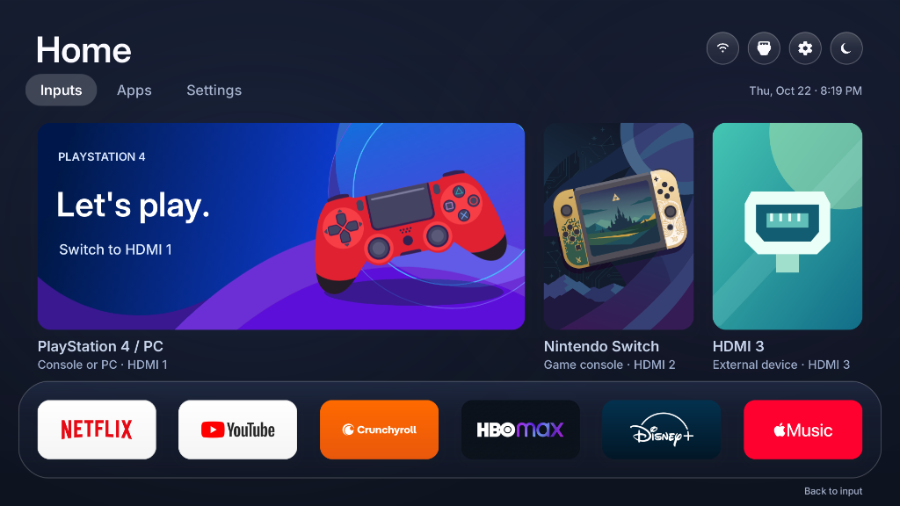

# Opt-quiet-tizen v1.0.1

[](LICENSE)
[](https://github.com/jss8649/quiet-tizen)
[](#)
[](https://tizen.org)
[](https://dotnet.microsoft.com)
[](https://samsung.com)
[](#performance-benchmarks)
[](CHANGELOG-v1.0.1.md)

A lightweight, ad-free, hardware-accelerated native launcher and optimization suite for **Samsung Tizen Smart TVs**. 

> [!NOTE]
> This repository is an **enhanced fork** of the foundational work [Quiet Tizen](https://github.com/jss8649/quiet-tizen) created by **jss8649**. It preserves the original author's research and agentic workflows while adding native D-pad icon reordering, tactile hardware audio, Apple TV-styled fluid focus animations, dynamic console artwork, real-world retail QLED benchmarks, and automated 1-click deployment tools.

> [!IMPORTANT]
> **Release Status:** Opt-quiet-tizen is currently in **Beta, but rock-solid and stable enough for daily use** as your TV's primary home screen. All core flows (HDMI port switching, streaming apps launch, D-pad navigation, volume/brightness controls, and sleep timers) are tested live on retail hardware and run 100% autonomously without external servers or cloud dependencies.

---

## 📸 Preview



*Quiet Home running live on a Samsung QLED TV: distraction-free layout with direct HDMI inputs, your favorite streaming apps, quick settings, and zero sponsored bloatware (And to my liking, no recommended content).*

---

## 🚀 Why this Fork? (Key Enhancements)

While the original upstream repository documented a targeted case study on a single U8000 model, this fork transforms Quiet Tizen into **Opt-quiet-tizen v1.0.1**, a **practical, feature-complete daily driver**:

1. **📱 Native Remote-Control Icon Reordering**:
   - Long-press **OK / Enter** for 500 ms on any app icon to enter interactive edit mode.
   - Distinct amber/gold focus ring with elevated card z-index.
   - Move apps fluidly across grid slots and multiple pages using the D-pad arrows.
   - Atomic instant persistence directly to local storage (`apps.json`).
2. **🍏 Fluid Apple TV-Styled Focus Animations**:
   - Natural, organic scale, depth, and elevation transitions styled after **Apple TV (tvOS)**.
   - Cards smoothly zoom and elevate with hardware-accelerated cubic easing when navigating via the remote.
   - Driven directly by the native Tizen DALi GPU compositor at a solid **60 FPS** without web DOM layout shifts.
3. **⚡ Native TV Audio Feedback & Toggle**:
   - Integrated with Samsung's native system audio feedback (`/usr/share/feedback/sound/operation/move.wav` via `libmmfkeysound.so.0`), delivering the authentic TV remote navigation click with zero latency and an on/off sound toggle.
4. **🔧 Dedicated Launcher Preferences Modal ("Preferencias del launcher")**:
   - Access via the dedicated **Wrench icon (`🔧`)** in the top-right toolbar.
   - Clean UI without bracket clutter: directional arrows (`◀ Option ▶`, `OK`) for effortless remote control.
   - Customize HDMI 1, 2, and 3 names and descriptions on the fly, with quick presets for consoles, PCs, and streaming boxes.
   - Integrated **10-Language Switcher**: Español, English, Deutsch, Português, Français, 中文 (Mandarin), 日本語, 한국어, हिन्दी, and العربية.
   - **Sound & Animation Toggles**: Customize sound effects and switch between fluid Apple TV animations or instantaneous (0 ms) snap navigation.
5. **🖼️ Dynamic HDMI 1 Hero Artwork**:
   - Custom-crafted landscape vector illustrations for **Xbox Series X / S**, **Nintendo Switch**, **Apple TV 4K**, **Gaming PC**, **Blu-ray / DVD**, **Cable TV / Box**, and **PlayStation 4 / 5**.
   - Dynamically updates the main Hero card in real time as you adjust your presets, with dimension-isolated caching preventing portrait/landscape distortion.
6. **📏 Dynamic Tab Pill Sizing**:
   - Real-time calculation of tab header widths (*Home*, *Apps*, *TV Settings*) based on translated string length and script density.
   - Completely eliminates ellipsis truncation (e.g. `Paramètr...`, `Configura...`, `TV-Einste...`).
7. **📄 Smart Pagination Dots for Apps**:
   - Dynamic page indicator (● ○ ○) in the Apps library when apps span multiple pages, deactivated when single-page to conserve memory.
8. **🎨 Crisp 1:1 Vector & Hi-Res Graphics Pipeline**:
   - Custom high-definition assets for modern consoles and streaming services (**Netflix**, **YouTube**, **Crunchyroll**, **HBO Max**, **Disney+**, **Apple Music**, and more).
   - Seamless return from third-party apps with zero multi-frame resize glitch.
9. **📊 Tested & Verified on Modern QLED Hardware**:
   - Verified on physical retail hardware: **Samsung QLED QN55Q7FAAPXPA** running firmware T-RSLFUABC-0090-1300.9 (Tizen 9.0 / RoseL platform).
10. **📦 Compilación reproducible y firma vinculada a tu TV**:
   - Código fuente abierto estructurado para que cualquier usuario compile localmente con .NET 6 y firme con su propio certificado Samsung vinculado al DUID de su televisor.
   - Soporte para variante Full y variante Lite (sin privilegios privados). Consulta la [Guía de Compilación e Instalación](#-compilar-e-instalar-en-tu-propio-tv-build--install-guide).

---

## ⚡ Performance Benchmarks

Smart TV SoCs have limited CPU horsepower. Architectural choices dictate whether your home screen feels like a sluggish web page or an instant gaming console.

Here is the real-world performance measured live on a physical **Samsung QN55Q7FAAPXPA**:

| Metric | Stock Samsung Smart Hub | Web Launchers (Free My TV / TizenBrew) | Opt-quiet-tizen v1.0.1 (Beta) |
|---|---|---|---|
| **Underlying Engine** | Heterogeneous (native shell + web widget embeds + ad network) | Chromium/WebKit Web Engine inside container | **Native .NET 6.0 with Tizen NUI / DALi GPU pipeline** |
| **First UI Render Time** | 2,400 – 4,500 ms (ad network delay) | 1,200 – 2,200 ms (DOM parse & layout) | **92 – 104 ms** (measured live) |
| **D-Pad Navigation Latency** | 180 – 350 ms | 220 – 450 ms (event loop queue) | **< 16 ms** (direct hardware event loop) |
| **Display Refresh Rate** | 25 – 45 FPS (stutter during ad refreshes) | 15 – 25 FPS (CPU throttling on CSS blur) | **Solid 60 FPS** (hardware compositing) |
| **Focus Animation Feel** | Clunky step animations | CSS transition drops frames on blur | **Smooth Apple TV-styled hardware zoom & easing** |
| **Tactile Audio Latency** | ~120 ms | > 200 ms (Web Audio context) | **< 5 ms** (`libmmfkeysound.so.0`) |
| **Network Traffic on Launch** | Heavy (telemetry & dynamic ad banners) | Moderate/Heavy (TMDB API, weather, remote images) | **0 bytes** (100% offline & autonomous) |
| **Available RAM (`MemAvailable`)** | ~500 – 540 MiB | ~520 – 580 MiB | **~900 – 922 MiB** available for gaming & apps |
| **App Reordering Speed** | Slow carousel editing with cloud sync | DOM re-render with layout shift | **< 5 ms** ($O(1)$ memory swap + atomic save) |

> [!TIP]
> For a detailed technical breakdown of memory graphs and graphics pipelines, read [docs/07-performance.md](docs/07-performance.md).

---

## 🎮 Features

- **Direct Hardware Inputs**: Instant 1-click switching to HDMI 1, HDMI 2, or HDMI 3 without traversing deep vendor menus.
- **Apple TV (tvOS) Motion & Aesthetics**: Silky-smooth focus transitions, subtle depth elevation, and reactive cards designed for tactile remote navigation.
- **Native Quick Settings**: Adjust Volume, Brightness, Game Mode, Sleep Timer, and Mute directly on screen without opening Samsung's full-screen menu.
- **Dark & Light Mode**: Built-in SVG-rendered themes switchable with one click from the toolbar.
- **DualSense / Bluetooth Pairing**: Direct shortcut to Samsung's Bluetooth controller pairing subsystem.
- **Zero Sponsored Ads**: No sponsored tiles, no TV Plus autostart, and no background tracking daemons.
- **Automatic State Persistence**: Preserves your custom app order, selected theme, and last-used input across full cold restarts.

---

## 🕹️ How to Reorder Apps on your TV

App reordering works natively using only your standard TV remote:

```
[ Focus on App ] ──( Hold OK for 500ms )──> [ Ring turns Gold / Elevated ]
                                                         │
                                        ( Use Arrow Keys: ◄ ▲ ▼ ► )
                                                         │
                                                         ▼
[ Position Saved ] ◄──( Press OK or BACK )── [ App Swaps Position ]
```

1. Navigate to the **Apps** tab.
2. Focus on any app you want to reposition.
3. **Hold the OK / Enter button** on your remote for ~500 ms.
   - The card elevates and the focus ring turns **bright gold**.
   - The status bar displays: `Mover '<App>' con flechas · OK para fijar`.
4. Use the **Arrow keys** (Up, Down, Left, Right) to move the card across slots and pages.
5. Press **OK / Enter** (or **BACK**) to drop the card and save your changes permanently.

---

## 🚀 Getting Started

### 🤖 Using with an AI Coding Agent

This repository is completely structured to be agent-readable. If you are using Codex, Claude, ChatGPT, or Antigravity, clone the repository, open it in your assistant workspace, and hand it the original author's prompt:

> *Read README.md and AGENTS.md, then inspect the documentation before touching my TV. Help me reproduce Quiet Tizen on a TV I own. First identify its exact model, firmware and runtime, compare them with the tested profile, and show me any compatibility gaps. Keep HDMI, sound, networking, Bluetooth and accessibility working. Prefer HDMI and minimize smart features; keep the streaming apps I choose. Back up my actual settings and prepare rollback before each change. Install and verify Quiet Home before assigning it to Home/startup or replacing the slow settings sidebar. Use the measured findings and known limitations rather than assuming every package is spyware or promising a particular speed improvement.*

---

### 📋 Prerequisites (Must-Haves)

Before deploying to your TV, ensure your PC and TV have the following requirements ready:

#### 1. TV Requirements
* **Samsung Smart TV** running Tizen 6.5, 7.0, 8.0, or 9.0.
* Connected to the **same local Wi-Fi or Ethernet network** as your computer.
* **Developer Mode enabled** (instructions in Step 1 below).

#### 2. PC Requirements (Must-Haves)
* **Python 3.10+**: Ensure you tick the checkbox *"Add Python to PATH"* during installation ([python.org](https://www.python.org/downloads/)).
* **Samsung Smart Development Bridge (`sdb.exe`)**: Required to establish the authenticated communication channel with the TV over port `26101`. Due to Samsung's proprietary license, SDB cannot be redistributed inside open-source repositories. Choose one of two options to obtain it:

  * **Option A: Tizen CLI Tools Only (Recommended — Lightweight ~100 MB)**
    1. Download the standalone **Tizen Studio CLI** installer from the [Tizen Developer Download Page](https://developer.tizen.org/development/tizen-studio/download).
    2. Run the installer and add the `tizen-studio/tools` directory to your Windows system `PATH` (or place `sdb.exe` inside the project folder).
    3. Verify in your terminal: `sdb version`.
  
  * **Option B: Tizen Studio with IDE (Full Development Suite — ~5 GB)**
    1. Download and install **Tizen Studio with IDE** from the [Tizen Developer Download Page](https://developer.tizen.org/development/tizen-studio/download).
    2. Includes the full graphical suite: **Tizen Device Manager**, Certificate Manager, and official emulators.
    3. The deployment script automatically discovers `sdb.exe` at `C:\tizen-studio\tools\sdb.exe`.

---

## 🔨 Compilar e instalar en tu propio TV (Build & Install Guide)

Debido a que el firmware de Samsung TV exige que todo paquete `.tpk` esté firmado con un certificado de distribuidor vinculado al **DUID (Device Unique ID)** de un televisor específico, **no es posible distribuir un binario pre-firmado genérico** para todos los usuarios. Cada usuario compila y firma con su propio perfil de certificado Samsung.

Sigue estos 8 pasos en orden para compilar e instalar en tu TV:

### Paso 1: Requisitos previos en la PC
- **.NET 6.0 SDK**: Instalado y disponible en tu terminal (`dotnet --version`). Si lo instalaste en una ruta personalizada, define la variable de entorno `DOTNET`.
- **Python 3.10+**: Con la opción *"Add Python to PATH"* habilitada.
- **Tizen Studio con TV SDK & Tools**:
  1. Descarga e instala **Tizen Studio with IDE** desde el [sitio oficial de desarrolladores de Tizen](https://developer.tizen.org/development/tizen-studio/download).
  2. Abre el **Tizen Package Manager** (`Tools > Package Manager`).
  3. En la pestaña **Main SDK**, instala `Tizen SDK tools`.
  4. En la pestaña **Extension SDK**, instala `TV Extensions-6.5` (o la versión que corresponda a tu TV) y **Samsung Certificate Extension** (obligatorio para el Paso 3).
  5. Asegúrate de que `tizen-studio/tools` y `tizen-studio/tools/ide/bin` estén en tu `PATH` del sistema para disponer de los comandos `sdb` y `tizen`.

### Paso 2: Conectar el televisor (Developer Mode & Device Manager)
1. **Activar Developer Mode en el TV**:
   - Abre la pantalla de **Apps** en tu televisor.
   - En tu mando a distancia físico (o app remota con teclado numérico), presiona los números **`1` `2` `3` `4` `5`** en secuencia.
   - En la ventana modal de *Developer Mode*, cambia el interruptor a **ON**.
   - En el campo **Host PC IP**, introduce la dirección IP local de tu PC (ej. `192.168.1.50`).
   - Mantén presionado el botón **Power** del mando físico durante 5 segundos hasta que el TV se apague y vuelva a encender mostrando el logotipo de Samsung/QLED (reinicio en frío indispensable).
2. **Registrar y conectar en Device Manager**:
   - Abre **Tizen Device Manager** desde Tizen Studio (`Tools > Device Manager`).
   - Haz clic en el icono de **Remote Device Manager** (arriba a la derecha).
   - Haz clic en **Scan** o pulsa **+** para agregar manualmente la IP local de tu TV (puerto `26101` por defecto).
   - Conecta el dispositivo. Al conectarse, aparecerá tu televisor en la lista principal.
   - Selecciona el televisor y anota su **DUID** visible en el panel de propiedades (*Properties*) de la derecha.

### Paso 3: Habilitar la extensión de certificados Samsung
1. Abre **Tizen Package Manager** (`Tools > Package Manager`).
2. Selecciona la pestaña **Extension SDK**.
3. Localiza **Samsung Certificate Extension** y haz clic en **Install**.
4. Reinicia Tizen Studio para asegurar que la extensión quede registrada.

### Paso 4: Crear tu perfil de certificado Samsung (Author + Distributor)
> [!CAUTION]
> **Advertencia crítica sobre el Error -12 (`Check certificate error [-12]`):**  
> Tu perfil DEBE contener certificados emitidos por **Samsung**, NUNCA mezcles un certificado genérico de desarrollador Tizen con uno de Samsung. Ambos (Author y Distributor) deben ser de tipo Samsung, y el distribuidor debe incluir explícitamente el DUID de tu televisor.

1. En Tizen Studio, abre `Tools > Certificate Manager`.
2. Pulsa en el botón **+** (New Certificate Profile).
3. Selecciona **Samsung** (¡NO Tizen!) y pulsa *Next*.
4. Selecciona **TV** y pulsa *Next*.
5. Asigna un nombre al perfil (ej. `SamsungTVProfile`).
6. **Author Certificate**:
   - Selecciona *Create a new author certificate*.
   - Inicia sesión con tu cuenta gratuita de **Samsung Developers**.
   - Completa el asistente para generar tu clave y certificado de autor Samsung.
7. **Distributor Certificate**:
   - Selecciona *Create a new distributor certificate*.
   - Selecciona el tipo de privilegio (*Public* o *Partner*).
   - En el campo de dispositivos (**DUID**), asegúrate de que esté seleccionado o ingresa manualmente el DUID de tu TV obtenido en el Paso 2.
   - Completa el asistente.
8. Verifica que el perfil recién creado aparezca con un check azul como el perfil activo por defecto.

### Paso 5: Elegir la variante a compilar (Full vs Lite)
El proyecto ofrece dos variantes según tu nivel de acceso y necesidades:

| Característica | Variante Lite (`--variant lite`) | Variante Full (`--variant full`) |
|---|---|---|
| **Requisitos de instalación** | **Ninguno especial**; instala directamente como app regular de TV | Requiere proceso de acceso vendor/ ([docs/02-access.md](docs/02-access.md)) |
| **Lanzamiento de Apps (Dock & Biblioteca)** | ✅ Totalmente soportado (APIs públicas) | ✅ Totalmente soportado |
| **Entradas HDMI (Cambio directo de fuente)** | ✅ Vía AppControl público de Tizen | ✅ Vía AppControl público de Tizen |
| **Reordenamiento interactivo con mando** | ✅ Sí (anillo dorado, guardado atómico) | ✅ Sí (anillo dorado, guardado atómico) |
| **Rendimiento GPU DALi / Temas Claro-Oscuro**| ✅ 60 FPS fluidos | ✅ 60 FPS fluidos |
| **Control de volumen / mute en pantalla** | ❌ Omitido (requiere API privada Samsung) | ✅ Soportado (`libcapi-media-sound-manager-tv`) |
| **Ajuste de brillo / modo juego en pantalla**| ❌ Omitido (requiere API privada Samsung) | ✅ Soportado (`libsettings-api`) |

*Para usuarios que desean una instalación directa y sin tocar permisos internos del sistema, se recomienda la **Variante Lite**.*

### Paso 6: Compilar con `tools/build.py`
En tu terminal en la raíz del repositorio:

- **Para compilar la Variante Lite (Recomendada para empezar)**:
  ```sh
  python tools/build.py launcher --variant lite
  ```
  *Genera: `opt-quiet-tizen-lite-unsigned.tpk`*

- **Para compilar la Variante Full**:
  ```sh
  python tools/build.py launcher --variant full
  ```
  *Genera: `opt-quiet-tizen-full-unsigned.tpk`*

*(Nota: Si tus ensamblados de Tizen no están en `.local/tv-framework`, puedes indicar su ubicación con `--framework <ruta>` o mediante la variable de entorno `TIZEN_FRAMEWORK`).*

### Paso 7: Firmar el paquete con tu perfil Samsung
Utiliza la herramienta CLI de Tizen Studio indicando el nombre de tu perfil creado en el Paso 4:

```sh
# Para Variante Lite:
tizen package -t tpk -s <NOMBRE_DE_TU_PERFIL_SAMSUNG> -- opt-quiet-tizen-lite-unsigned.tpk

# Para Variante Full:
tizen package -t tpk -s <NOMBRE_DE_TU_PERFIL_SAMSUNG> -- opt-quiet-tizen-full-unsigned.tpk
```

Alternativamente, puedes usar el menú gráfico de Tizen Studio en `Tools > Package > Sign .tpk`. El comando generará el paquete firmado listo para instalar.

### Paso 8: Instalar en tu televisor con SDB
Asegúrate de estar conectado a tu televisor y envía el paquete firmado:

```sh
# Conectar al televisor si no está conectado:
sdb connect <IP_DE_TU_TV>

# Instalar el paquete firmado en el TV:
sdb install opt-quiet-tizen-lite.tpk
```

¡Listo! El launcher aparecerá instalado en tu televisor y podrás iniciarlo directamente desde la pantalla de aplicaciones.

---

## 📚 Technical Documentation & Walkthrough

Inherited from the original project and updated for modern platforms:

1. [Understand compatibility and inventory the TV](docs/01-inventory.md).
2. [Enable Developer Mode and check temporary access](docs/02-access.md).
3. [Take snapshots and apply selected cleanup](docs/03-cleanup.md).
4. [Build, install and assign Quiet Home](docs/04-launcher.md).
5. [Pair a DualSense using the TV's Bluetooth support](docs/05-controller.md).
6. [Customize apps, fetch artwork and keep it preloaded](docs/06-artwork.md).
7. [Diagnose slow streaming apps and view benchmarks](docs/07-performance.md).
8. [Understand privacy and telemetry findings](docs/08-privacy.md).
9. [Restore the original experience safely](docs/09-recovery.md).

---

## 🔬 Tested Hardware Comparison

| Item | Original Upstream Baseline | Opt-quiet-tizen v1.0.1 (Beta) |
|---|---|---|
| **Model** | `UN75U8000FFXZA` (2025 U8000F) | `QN55Q7FAAPXPA` (QLED 55") |
| **Firmware** | `T-KSU2EFAKUC-0090-1300.9` | `T-RSLFUABC-0090-1300.9` |
| **Platform** | Tizen 9.0, Linux 5.4.261, ARMv7 | Tizen 9.0, Linux 5.4.261, ARMv7 (RoseL) |
| **Runtime** | .NET Runtime 6.0.9 | .NET Runtime 6.0.9 |
| **Animations** | Static snap navigation | **Fluid Apple TV-styled focus zoom & depth easing** |
| **Icon Reordering** | Fixed static JSON order | **Interactive D-pad 500ms long-press reorder** |
| **Navigation Click** | System default / silent | **Native `libmmfkeysound.so.0` tactile sound** |
| **Deployment** | Multi-step SDB shell scripts | **1-click automated script (`deploy-to-tv.bat`) + TPK** |

---

## 🛠️ Project Structure

```
quiet-tizen/
├── launcher/
│   ├── src/                 # Native C# NUI Application (Home.cs, AppLibrary.cs)
│   ├── assets/              # Hi-res artwork, vector SVGs, custom click audio
│   └── probe/               # Hardware diagnostic tool (Probe.cs)
├── profiles/                # Tested TV hardware signatures (QN55Q7F, U8000F)
├── recipes/                 # Shell scripts for snapshot, launcher, and recovery
├── tools/                   # Build scripts, TV access bridge (tv.py), packaging
└── docs/                    # Technical documentation
    ├── 01-inventory.md      # Hardware and firmware compatibility inspection
    ├── 02-access.md         # SDB authentication and session security
    ├── 03-cleanup.md        # Registry snapshots and safe daemon disabling
    ├── 04-launcher.md       # Launcher integration and assembly replacement
    ├── 05-controller.md     # DualSense Bluetooth controller pairing
    ├── 06-artwork.md        # Texture caching and pixel-perfect rendering
    ├── 07-performance.md    # Real-world benchmark data & architecture analysis
    ├── 08-privacy.md        # Network telemetry findings
    └── 09-recovery.md       # Safe uninstallation and stock restoration
```

---

## 🛡️ Open Source Compliance, Attribution & Credits

This project strictly adheres to open source principles, licensing agreements, and utmost respect for the original authors:

- **Original Project & Research**: Created by **jss8649** ([@jss8649](https://github.com/jss8649)) at [quiet-tizen](https://github.com/jss8649/quiet-tizen). All credit for the reverse engineering methodology, architecture design, and original case study belongs to the original author (jss8649).
- **Visual Design Concept**: Adapted from the open-source [Free My TV](https://github.com/simbasjungles/free-my-tv) project by Simba's Jungles. This repository is a native Tizen C#/NUI rewrite of the visual approach, not an Android port.
- **Temporary Access Route**: The archive-launcher access mechanism is based on [samsung-tv-root](https://github.com/chris-ritsen/samsung-tv-root) by Chris Ritsen.
- **License**: All original and modified code is licensed under the [MIT License](LICENSE).
- **Third-Party Assets**:
  - Fonts: Inter Font Family (SIL Open Font License 1.1).
  - Material Symbols: Apache 2.0 license.
  - See [NOTICE.md](NOTICE.md) and [docs/provenance.md](docs/provenance.md) for full license texts and commit provenance.
  - **No proprietary Samsung firmware, stock application binaries, or protected television backups are included in this repository.**

---

## ⚠️ Disclaimer

This is an independent open-source project. Samsung, Tizen, QLED, PlayStation, Nintendo Switch, and other brand names are trademarks of their respective owners. This project is not affiliated with, endorsed by, or sponsored by Samsung Electronics Co., Ltd. Use at your own discretion.
